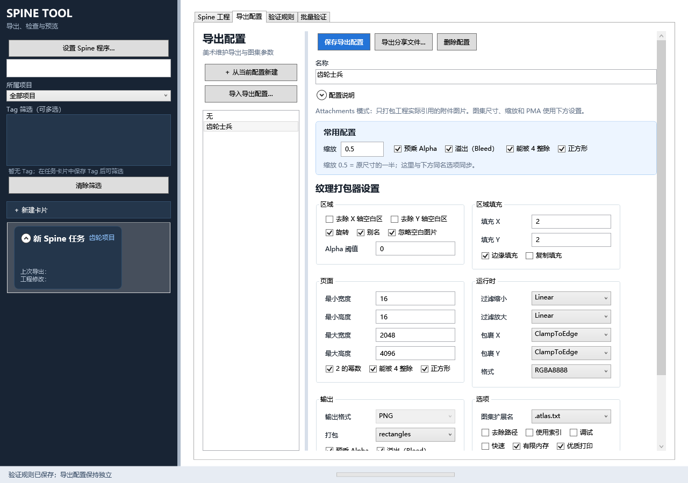

# SpineTool

面向美术工作流的 Windows 工具：**导出 Spine 资源、检查交付规范、独立预览动画与骨骼点**。

[下载 Windows 便携版](https://github.com/1liil1/SpineTool/releases/latest) · [美术使用说明](docs/USER_GUIDE.md) · [配置分享](docs/CONFIGURATION.md) · [开发构建](docs/DEVELOPMENT.md) · [常见问题](docs/TROUBLESHOOTING.md)

## 解决什么问题

- **导出**：保存并复用缩放、预乘 Alpha、图集尺寸等配置，减少重复设置和参数遗漏。
- **验证**：交付前检查动画、事件、骨骼、插槽、命名和文件完整性，区分阻断错误与日志警告。
- **预览**：不用打开整个游戏工程，用独立 Unity + Spine Runtime 检查动作、Skin、动画事件和子弹发射骨骼点。
- **工程管理**：卡片记录备注、Tag、所属项目、最近修改、导出和验证信息，支持筛选与输出目录历史。

## 快速开始

1. 在 [Releases](https://github.com/1liil1/SpineTool/releases) 下载 `SpineTool-Win64-*.zip`，**完整解压**到可写文件夹。
2. 进入 `App`，直接运行 `SpineTool.exe`。独立预览运行 `App/Previewer/SpinePreviewer.exe`。
3. 点击“设置 Spine 程序…”，选择本机已安装并激活的 **Spine 4.1 / Spine.com**。
4. 新建卡片，选择 `.spine` 工程，分别选择导出配置和验证规则，再指定输出根目录。
5. 勾选需要的步骤并点击“一键执行”，或分别使用导出、验证、预览按钮。

便携包包含 .NET 运行库与预览器；不包含 Spine 编辑器或游戏美术资源。使用预览器涉及 Spine Runtimes 许可，详见 [第三方许可](Licenses/README.md)。当前预览器针对 **4.1** 数据，不能直接播放 3.8 数据。

## 导出配置与独立验证规范



导出 JSON、SKEL、Atlas 和 PNG，默认采用 Spine 官方 **Attachments** 模式，只打包工程实际引用的附件图片，避免把未使用的 BG 也打进图集。

常用区提供缩放、PMA、Bleed、能被 4 整除、正方形；完整选项按 Spine 打包界面的区域、区域填充、页面、运行时、输出、选项排列。参数可建立副本、保存并通过单个 JSON 分享文件传给其他同学，依赖设置一起带走。

**修改后需要点击“保存导出配置”，再回工程选择该配置。** 顶部常用区和下方完整设置的同名选项同步。美术维护导出参数，规范维护者提供验证规则，两项互不绑定。

| 内置项 | 导出设置 | 验证规范 |
| --- | --- | --- |
| 无 | 通用 JSON / Binary；Attachments | 关闭验证，无动画或骨骼要求 |
| 齿轮士兵 | JSON / Binary；Attachments；PMA | 必须有 `attack` 动画，且其时间轴包含 `attack` 事件；缺少 `BulletPostion` 只输出 Warning |

`BulletPostion` 是内置规范沿用的拼写，自定义规则可用其他骨骼名。只声明事件名、不把事件添加到动画时间轴，仍不能通过事件检查。

## 独立预览器

- 递归扫描整个资源文件夹及全部子文件夹，按相对路径显示资源，支持筛选；同名骨架按目录隔离，JSON / SKEL 作为备用格式。
- 切换动画、Skin、速度与暂停；拖动、滚轮缩放、居中；实时背景颜色与棋盘背景。
- 输入任意骨骼名，用红点跟随动画检查发射位置，显示局部、Spine 世界与预览世界坐标。
- 底部可拖动时间轴显示进度、事件位置与参数，点击事件定位；动画按钮显示时长，拖动后暂停并可继续循环播放。
- 支持 `SkeletonAnimation` 与 `SkeletonGraphic` 两种显示模式。

## 运行与开发环境

| 项目 | 版本 / 平台 |
| --- | --- |
| 便携版 | Windows 10 / 11，x64 |
| 主工具与命令行工具 | C#、.NET 8、WPF |
| 预览工程 | Unity 2022.3.62f2 |
| Spine 数据 | 4.1 |
| Spine Unity / URP | 4.1.43 / 4.1.27 |
| Unity URP | 14.0.12 |

源码仓库保留 `Tools/` 与最小 `Packages/` 依赖，可独立构建，不依赖原游戏工程。Spine 和 Unity 编辑器需要自行安装。

```text
Tools/SpineTool/            WPF 主界面、卡片和配置分享
Tools/SpineExporter/        Spine CLI、整理导出结果
Tools/SpineValidator/       检查规则和批量验证
Tools/SpinePreviewer/       独立 Unity 预览工程
Tools/*.Tests/             自动验证程序
Packages/Spine/             Spine Runtime 与 Unity 集成
Packages/Spine-URP/         Spine URP Shader
scripts/                   Windows 检查与发布脚本
docs/                      中文使用、配置、开发和排错说明
Licenses/                  第三方声明
```

## 验证与边界

- 已验证配置独立选择、保存、迁移、分享还原与多资源目录匹配。
- 原工作环境用 5 个资源完成两种预览模式共 10 次加载切换检查，游戏资源不随仓库发布。
- 用 Spine 3.8.75 示例验证过 Attachments 和 `square: true` 导出 1024×1024 PNG；这不代替美术机器上的 Spine 4.1 验收。
- “正方形未生效”的反馈尚未取得实际 PNG 和保存配置，不能仅凭缩略图认定画布尺寸。详见 [排查步骤](docs/TROUBLESHOOTING.md)。
- 正式输出已存在时不会自动覆盖；需更换输出根目录，或先备份旧资源。

## 许可与反馈

本仓库公开工具源码，原创代码暂未另行授予通用开源许可证。Spine Runtime 不采用 MIT 许可，Spine、Unity 与 .NET 各自遵循其许可，见 [Licenses](Licenses/README.md)。

问题或建议请提交 [Issue](https://github.com/1liil1/SpineTool/issues)，提供工具版本、Spine 版本、步骤及脱敏日志。请勿上传激活信息或不便公开的项目资源。
